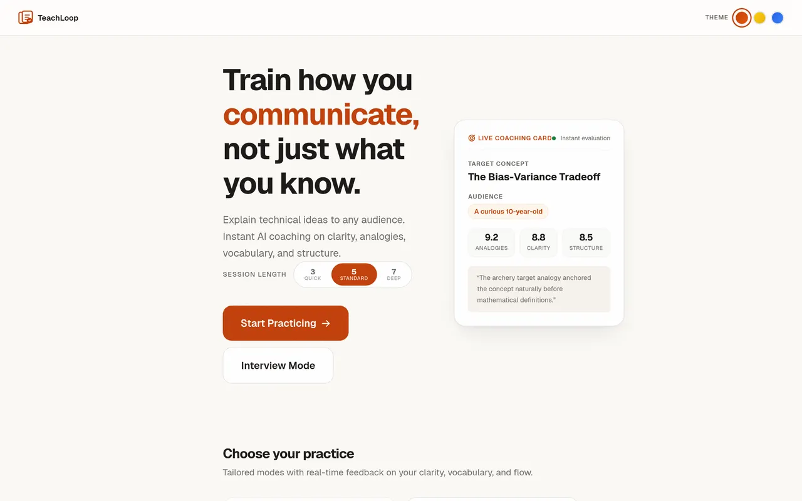
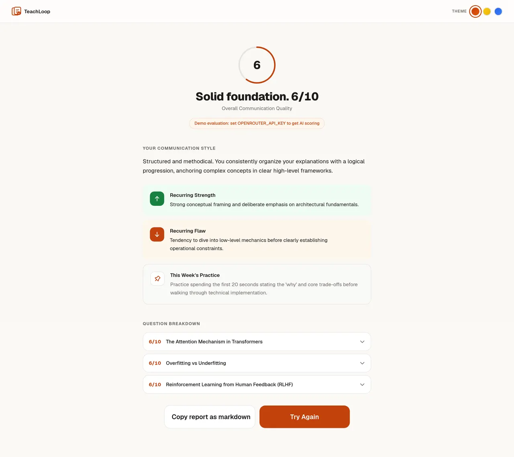

<div align="center">

# TeachLoop

**Train how you communicate, not just what you know.**

AI-powered communication coaching for technical professionals. Practice explaining concepts to different audiences, master system design communication, and get real-time feedback on clarity, structure, and vocabulary fit.

[](https://teach-loop-ten.vercel.app)

[](https://nextjs.org)
[](https://react.dev)
[](LICENSE)
[](https://teach-loop-ten.vercel.app)

👉 **[Try the Live Demo](https://teach-loop-ten.vercel.app)** 👈

</div>

---

## Why TeachLoop?

Technical professionals often struggle to explain what they know. You can ace a code review but freeze when an executive asks "what does this actually do?" TeachLoop closes that gap.

- **Explain to real audiences** — Not just other engineers. Practice explaining to a curious 10-year-old, a non-technical recruiter, an executive, or a senior AI engineer.
- **Master system design answers** — Tackle architecture questions under pressure with structured feedback on clarity, depth, and structure.
- **Generate custom topic sets** — Practice any topic on demand (Kubernetes, GraphQL, React, etc.) with AI-generated questions and progressive hints.
- **Sketch diagrams visually** — Explain architectures visually with an interactive whiteboard and automated layout evaluation.
- **Get structured AI feedback** — Scored on clarity, audience-fit, analogies, vocabulary, and confidence, complete with end-of-session synthesis reports.
- **Track your growth** — Review your past sessions with sparkline score trajectories and recurring pattern insights.

---

## How It Works

1. **Pick a Mode & Session Length** — Choose Teach Mode (5 target audiences), System Design Interview Mode, Custom AI Topics, or Whiteboard Sketch Mode. Set session length to 3 (Quick), 5 (Standard), or 7 (Deep) questions.
2. **Spin the Wheel** — A randomized question is selected from curated question banks or generated on-the-fly.
3. **Record Your Explanation** — Speak your answer via browser-native speech recognition or type it in. Tap progressive hints (Nudge, Concept Outline, Full Breakdown) whenever you need scaffolding.
4. **Get Instant AI Feedback** — Receive immediate dimensional scoring, strong points, and specific fixes per question, followed by an overarching session report and growth tips.

---

## Features

### Four Practice Modes

| Mode | What You Do | Sample Topics |
|------|------------|---------------|
| **Teach** | Explain a technical concept to a chosen audience persona | Backpropagation, RAG, The Attention Mechanism, Mixture of Experts |
| **Interview** | Answer system design & architectural questions under pressure | URL Shortener, CAP Theorem, Design a Rate Limiter, Eventual Consistency |
| **Custom** | Generate AI questions on any technical domain with progressive hints | Kubernetes, GraphQL, React Hooks, Distributed Caching |
| **Sketch (Whiteboard)** | Draw system diagrams on an interactive Excalidraw canvas | Rate Limiter Architecture, CNN Flow, DNS Resolution, Freeform |

### Five Audiences (Teach Mode)

Each audience comes with contextual coaching guidance:

- 🧒 **Curious 10-Year-Old** — Plain language, real-world analogies, no jargon
- 👔 **Non-Technical Recruiter** — Business outcomes, clear impact, accessible framing
- 🧑‍💻 **Junior Developer** — Technical depth with patience and solid fundamentals
- 🎩 **C-Suite Executive** — Strategic framing, ROI focus, high-level trade-offs
- 🤖 **Senior AI Engineer** — Full technical precision, edge cases, performance

### Configurable Session Length

- **3 Questions** — Quick practice (5–7 minutes)
- **5 Questions** — Standard session (10–15 minutes)
- **7 Questions** — Deep practice (20+ minutes)

### Intelligent Voice Input

Built-in Web Speech API integration with automatic cleanup:

- Removes filler words ("um," "uh," "like," "you know")
- Deduplicates repeated words
- Punctuation and capitalization formatting
- Real-time word count with ideal range guidance (80–200 words)

### Progressive Hint System

Three levels of hints per question — start with a nudge, escalate to a full explanation if needed:

1. **Nudge** — A gentle push in the right direction
2. **Concept Outline** — Key ideas organized for clarity
3. **Full Explanation** — The complete technical breakdown

### Session Reports & Growth Tracking

After completing a session, receive an end-of-session synthesis:

- **Communication style analysis** — How you naturally express ideas
- **Recurring strengths** — What you consistently do well
- **Growth areas** — Patterns to improve
- **Weekly practice tip** — A concrete action to try
- **Progress Tracking** — Up to 20 past sessions stored locally with sparkline trends and score badges (**Strong** · **Solid** · **Growing**)

---

## Screenshots

<div align="center">
  
  <br /><br />
  
</div>

---

## Quick Start

```bash
# Clone the repository
git clone https://github.com/bmo1177/TeachLoop.git
cd TeachLoop

# Install dependencies
npm install

# Start development server
npm run dev
```

Open [http://localhost:3000](http://localhost:3000) in your browser.

**No API key? No problem.** Without `OPENROUTER_API_KEY`, TeachLoop runs in **demo mode** with deterministic mock scoring — perfect for trying the full loop (teach → feedback → report) before configuring anything. Every screen clearly labels demo results, so it's never mistaken for real AI scoring.

### Prerequisites

- **Node.js** 18.18+ (20 or 22 recommended)
- **Optional AI keys** — NVIDIA NIM (recommended, free) or OpenRouter, both free-tier. Required only for real AI scoring and custom generated topics; otherwise demo mode.

### Environment Variables

| Variable | Required | Description |
|----------|----------|-------------|
| `NVIDIA_API_KEY` | No | From [build.nvidia.com](https://build.nvidia.com) — recommended provider (free endpoint, ~1-3s responses). Default model: `nvidia/nemotron-3.5-bolt-e4b`, override with `NVIDIA_MODEL` |
| `OPENROUTER_API_KEY` | No | Fallback provider from [OpenRouter](https://openrouter.ai/keys), used when no NVIDIA key is present. Override with `OPENROUTER_MODEL` |
| — | — | With **neither** key configured, the app runs in demo mode (deterministic mock evaluation, clearly labeled in the UI) |

---

## Scripts

| Command | Description |
|---------|-------------|
| `npm run dev` | Start development server |
| `npm run build` | Create production build |
| `npm run start` | Serve production build |
| `npm run lint` | Run ESLint checks |
| `npm run test` | Run Vitest unit test suite |
| `npm run test:watch` | Run Vitest in interactive watch mode |
| `npm run test:e2e` | Run Playwright end-to-end tests |

### Testing

TeachLoop maintains two automated testing suites:

- **Unit Tests (Vitest)** — Validates pure logic across transcript cleanup, speech fragmentation fixes, session history management, API response schema validators, prompt template builders, and deterministic demo mocks.
  ```bash
  npm run test
  ```
- **End-to-End Tests (Playwright)** — Exercises the entire user journey (Teach mode, audience selection, wheel transitions, answer submission, demo badges, full session report generation, and past session persistence) plus Excalidraw whiteboard flows.
  ```bash
  # Install Playwright Chromium and OS dependencies (Linux/macOS/Windows)
  npx playwright install --with-deps chromium
  npm run test:e2e
  ```

---

## Tech Stack

| Layer | Technology |
|-------|-----------|
| **Framework** | [Next.js 15](https://nextjs.org) (App Router) |
| **UI** | [React 19](https://react.dev) |
| **Whiteboard** | [Excalidraw](https://excalidraw.com) |
| **Animations** | [Motion](https://motion.dev) (Framer Motion) |
| **Typography** | [Geist](https://vercel.com/font) font family |
| **Icons** | [Phosphor Icons](https://phosphoricons.com) |
| **AI Backend** | [NVIDIA NIM](https://build.nvidia.com) (default `nemotron-3.5-bolt-e4b`) → [OpenRouter](https://openrouter.ai) fallback → deterministic demo mode |
| **Voice** | Web Speech API (browser-native) |
| **Storage** | localStorage (sessions, whiteboards, themes) |

---

## Architecture

```
app/
  page.js                          # App shell, state machine, error boundary
  layout.js                        # Root layout, fonts, metadata, theme script
  globals.css                      # Global styles and modular imports
  styles/                          # 17 modular CSS stylesheets
  api/eval/route.js                # AI evaluation and report proxy to OpenRouter
  components/
    screens/
      HomeScreen.js                # Hero, mode cards, session length picker, history
      AudienceScreen.js            # Audience persona selection
      WheelScreen.js               # Animated question selector wheel (reduced-motion aware)
      SessionScreen.js             # Question card, textarea, voice input, hint drawer
      FeedbackScreen.js            # Session synthesis report and style analysis
      CustomModeScreen.js          # Custom topic question generator
      CustomReviewScreen.js        # Review generated questions before starting
      WhiteboardScreen.js          # Interactive drawing workspace with AI layout evaluation
      LoadingEval.js               # Loading state animation
    ui/
      LogoMark.js                  # SVG logo mark
      Nav.js                       # Top navigation bar
      ProgressBar.js               # Session progress indicator
      ScoreRing.js                 # Circular animated score gauge
      Sparkline.js                 # Score trend sparkline
      WhiteboardCanvas.js          # Excalidraw canvas wrapper
      TemplateSelector.js          # Diagram templates
      NotesPanel.js                # Written notes for visual explanations
      OnboardingOverlay.js         # Guided onboarding tour
  data/
    questions.js                   # Teach + Interview question banks
    audiences.js                   # Audience definitions + coaching advice
    hints.js                       # 3-level progressive hints
    templates.js                   # Whiteboard diagram starting templates
  hooks/
    useVoice.js                    # Web Speech API hook with cleanup
    useSessionHistory.js           # Session history in localStorage
    useWhiteboardHistory.js        # Whiteboard sketch history in localStorage
    useOnboarding.js               # First-visit onboarding state
  lib/
    api.js                         # API helpers, prompt templates, whiteboard parser
  providers/
    ThemeProvider.js               # Theme context and theme switcher
```

---

## Themes

Three built-in themes, persisted in localStorage:

| Theme | Vibe |
|-------|------|
| **Sunrise Studio** | Warm neutrals, burnt orange accent — like a teacher's notebook *(default)* |
| **Chalkboard** | Dark surface, yellow accent — a warm study room |
| **Blue Hour** | Cool slate, blue accent — professional and calm |

Switch themes from the navigation bar. Your choice persists across sessions.

---

## Accessibility

TeachLoop is built toward WCAG 2.1 AA goals:

- **Keyboard navigation** with visible focus indicators on interactive elements
- **Reduced motion** — Fully respected via `prefers-reduced-motion` (including wheel spin bypass)
- **Screen reader support** — ARIA labels, live regions, semantic HTML
- **Voice + keyboard** — Input via Web Speech API with typed fallback
- **Skip links** — Jump directly to main content
- **Touch targets** — Minimum 44px on mobile
- **Safe area insets** — Proper padding on iOS devices
- **Print styles** — Clean layout when printing session reports

---

## Browser Support

| Browser | Voice Input | Notes |
|---------|-------------|-------|
| **Chrome** | Full support | Best experience — recommended |
| **Edge** | Full support | Same Chromium engine |
| **Safari** | Limited | Web Speech API support varies by version |
| **Firefox** | Limited | Web Speech API support varies by version |

Keyboard input works across all browsers. Voice input is a progressive enhancement.

---

## Security

- Rate limiting: 30 requests per minute per IP
- Origin validation on the API endpoint
- 15-second request timeout with exponential backoff retry
- Multi-tier response schema validation (evaluations, custom questions, and session reports)
- **Demo mode** — when no API key is configured the endpoint returns deterministic mock evaluations (clearly labeled `demo: true` in every response); no upstream LLM call is ever made without a key
- User input is length-capped (12,000 chars) and never executed server-side
- Security headers configured: `X-Frame-Options: DENY`, `X-Content-Type-Options: nosniff`, `Referrer-Policy: strict-origin-when-cross-origin`
- `X-Powered-By` header disabled

---

## Contributing

Contributions, suggestions, and issue reports are very welcome!

1. Fork the repository
2. Create your feature branch (`git checkout -b feature/my-new-feature`)
3. Commit your changes (`git commit -m 'Add my feature'`)
4. Push to the branch (`git push origin feature/my-new-feature`)
5. Open a Pull Request

---

## Known Limitations

- **localStorage Persistence** — Sessions and sketches are stored locally in browser storage. Clearing browser data clears your history. Cloud accounts and sync are on the roadmap.
- **Voice Recognition Browser Variance** — Built on the standard Web Speech API, which works best in Chromium browsers (Chrome, Edge). Safari and Firefox provide varied support; keyboard input works everywhere.
- **Free Tier AI Backend** — NVIDIA NIM free endpoint by default (OpenRouter free-tier fallback). Response latency and rate limits may vary based on upstream traffic.

---

## License

This project is licensed under the [MIT License](LICENSE) — see the [LICENSE](LICENSE) file for details.

---

<div align="center">

**Built with care for technical professionals who want to communicate as well as they code.**

</div>
